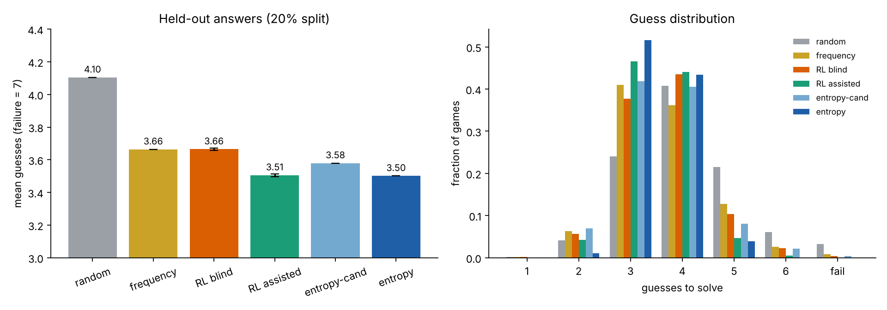

# Wordle solver: information theory vs. reinforcement learning

Two ways to play Wordle, compared head to head on the same word lists:

1. **Entropy solver** – greedily plays the guess that maximises the expected information
   (bits) about the hidden answer.
2. **RL agent** – a PPO-trained policy that scores candidate guesses with a small shared MLP.
   Two variants: **blind** (only letter statistics as features) and **assisted** (also gets
   entropy features).

Data: 2,309 answers, 12,953 allowed guesses (original Wordle lists). Failures (not solved in
6 guesses) count as 7 guesses in the averages.

## Results

Held-out evaluation: answers are split 80/20 with a fixed seed; the RL agents never saw the 461
test answers as targets. RL rows are the mean of 3 training seeds.

| Solver | Mean guesses (test) | Solve rate | Notes |
|---|---|---|---|
| Random (consistent word) | 4.10 | 96.7% | |
| Letter-frequency heuristic | 3.66 | 99.1% | |
| **RL blind** | **3.66** (3.657–3.668) | 99.6% | matches the heuristic, no look-ahead |
| Entropy, candidates only | 3.58 | 99.6% | |
| **RL assisted** | **3.51** (3.497–3.514) | 100% | ties the entropy solver |
| Entropy, all guesses | **3.50** | 100% | best |

On all 2,309 answers the entropy solver averages **3.463** (opener `soare`, 100% solved, max 6).




### What the numbers say
- **Entropy wins, or ties.** The learned policy with entropy features (3.505 mean over 3 seeds) is
  statistically indistinguishable from the entropy solver (3.501). Per answer it is better on
  170 words, worse on 169, and equal on 122, so there is no real difference.
- **Learning alone (blind) reaches the heuristic level, not the entropy level.** Without
  look-ahead features the agent plateaus at ~3.66, the same as a hand-written letter-frequency
  rule. All three seeds converged on the opener `stare`.
- **The assisted agent chose different openers** (`salet` for seeds 0 and 1, `raile` for
  seed 2) than the entropy solver (`soare`) yet scores the same, which shows that several
  openers are near-equivalent under the greedy criterion.
- **Hardest words** (highest average guesses across the entropy and RL solvers on the test
  split) include `joker`, `brown`, `witty`, `frame`, `goner`, `fight` and `paddy`. I did not
  investigate why; a likely cause is that many look-alike words survive the first guesses.

### Caveats (read before quoting the numbers)
- The assisted agent chooses among a **shortlist of 48 words ranked by entropy** (40 top-entropy
  words + up to 8 candidates), so it is "RL on top of an entropy prior", not RL from scratch.
  The blind agent's shortlist is ranked by letter statistics.
- The entropy solver uses a simple finishing rule (guess a candidate when ≤2 remain); the RL
  agents do not get that rule.
- The word lists are the original 2,309-answer Wordle lists with a uniform prior, so the
  numbers are not comparable with published results that use word frequencies or the NYT list.
- 300 PPO iterations × 128 episodes (~38k games) per seed; a longer run might close the small
  remaining gap, but I did not test that.

## Project layout
```
data/        answers.txt, allowed.txt (+ cached feedback_matrix.npy, git-ignored, rebuilt on first run)
src/
  feedback.py      feedback with correct duplicate letters, vectorised matrix
  features.py      per-word features + shortlist for the RL agent
  env.py           Gymnasium environment
  evaluate.py      run solvers over all answers
  solvers/         random, frequency, entropy, rl_agent
scripts/
  train_rl.py      PPO training    compare.py   held-out comparison    plots.py   figures
app/streamlit_app.py   enter your real Wordle feedback, get the best next guess
tests/             pytest suite (feedback edge cases, solvers, env)
results/           CSVs, figures, trained policies (*.pt)
```

## Reproduce
```bash
pip install -r requirements.txt
make test
make baselines                                   # random / frequency / entropy (~30 s)
python scripts/train_rl.py --mode assisted --seed 0 --iters 300   # ~14 min on 1 CPU thread
python scripts/train_rl.py --mode blind    --seed 0 --iters 300   # ~3.5 min
python scripts/compare.py && python scripts/plots.py
make app                                         # interactive helper
```

## Design notes
- **Feedback** is a base-3 integer (0–242). Greens are assigned first, then yellows only up to
  the remaining count of each letter; this is the classic duplicate-letter bug and is unit-tested.
- **Feedback matrix** `[12953, 2309]` is precomputed once, so every entropy score is a table
  lookup plus a `bincount`.
- **Policy** is word-agnostic: one MLP scores each shortlisted word from its features, so it
  generalises to answers it never trained on (train and test scores are close).
- **Reward** is −1 per guess, −4 extra on failure, plus potential-based shaping
  (0.3 × bits of information gained), which does not change the optimal policy but gives
  a learning signal when a random policy almost never wins.

## Ideas to extend
Hard mode, an adversarial (Absurdle-style) opponent, two-step look-ahead, word-frequency priors,
and training the agent without any shortlist.
